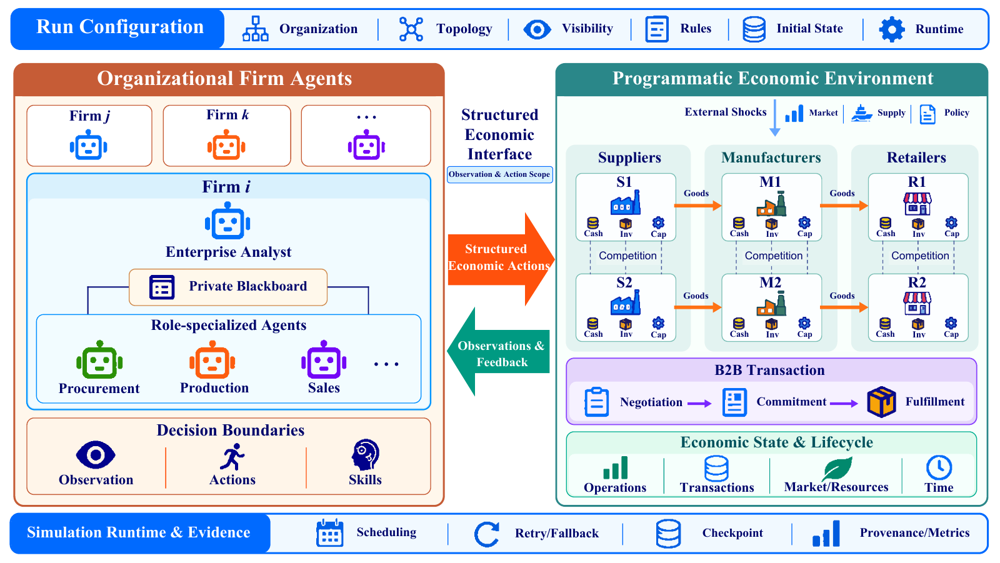
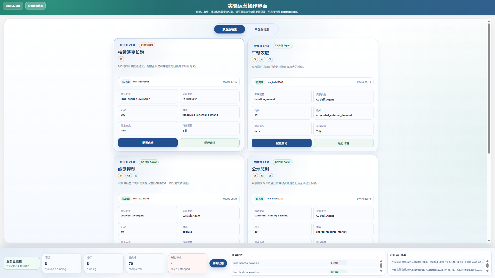
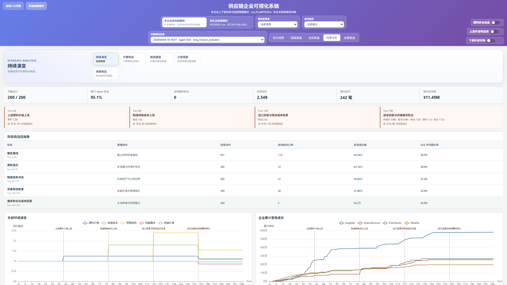

<div align="center">

# SupplyChainAgent

**Organizational enterprise agents in a configurable supply-chain economy**

Agent Skills &nbsp; | &nbsp; B2B Exchange &nbsp; | &nbsp; Economic Dynamics &nbsp; | &nbsp; Experiment Interface

[Quick Start](#quick-start) · [Scenarios](#scenarios) · [Agent Setup](#agent-setup) · [Documentation](#documentation)

</div>

SupplyChainAgent models enterprises that make decisions, coordinate departments, and trade with one another. Each enterprise combines an analyst with role-specific agents and a private blackboard. A programmatic economic environment advances inventory, cash, capacity, production, deliveries, and transaction commitments across simulation rounds.

Use **Agent Skills** for model-driven decisions or a **scripted controller** for deterministic reference runs. The browser-based experiment interface provides configuration, job management, operating-state inspection, and outcome analysis.



*Architecture overview (Figure 1 in the manuscript). Enterprise analysts, role-specialized agents, and private blackboards interact with a programmatic supply-chain environment through structured actions, observations, and feedback. The topology shown is an example; firms, departments, information visibility, initial state, and economic mechanisms are configured per scenario. [Open the full-resolution PDF](docs/assets/architecture-overview.pdf).*

## What You Can Explore

| Capability | What it provides |
| --- | --- |
| Organizational enterprise agents | Enterprise analysis, department decisions, Skills, and private coordination |
| Supply-chain transactions | Purchase requests, counterparty responses, confirmed orders, delivery, and settlement |
| Economic mechanisms | Price feedback, upstream demand propagation, peer visibility, and shared-resource dynamics |
| Controlled experiments | Configurable initial conditions, controller policies, and scheduled external shocks |
| Inspectable runs | Observations, actions, execution feedback, exchange snapshots, metrics, and checkpoints |
| Storage integration | Filesystem run archives, an SQLite operations mirror, and optional ORM storage |

## Quick Start

The clean-install smoke test was verified with **Python 3.12.3**, **Node.js 18.19.1**, and **npm 9.2.0**. The startup script requires Bash. Scripted runs work without model credentials; Agent runs require the model configuration described below.

### 1. Install Dependencies

Run from the repository root:

```bash
python3 -m venv .venv
.venv/bin/python -m pip install -r requirements.txt
npm --prefix visualization ci
```

### 2. Start the Experiment Interface

```bash
bash scripts/start_integrated_app.sh
```

The script starts both services and checks backend readiness before launching the interface.

| Service | Default address |
| --- | --- |
| Experiment interface | <http://127.0.0.1:3000> |
| Simulation and operations API | <http://127.0.0.1:8000> |
| Interactive API documentation | <http://127.0.0.1:8000/docs> |

Keep the terminal open while using the application. `Ctrl+C` stops the services. To select a different interpreter or avoid occupied ports:

```bash
PYTHON_BIN=.venv/bin/python BACKEND_PORT=8001 FRONTEND_PORT=3001 \
  bash scripts/start_integrated_app.sh
```

### 3. Run Your First Experiment

Open the experiment interface, choose a multi-enterprise scenario and its **scripted** configuration, set the round count, and start the job. Inspect job progress, enterprise actions, and scenario outcomes after execution.

A fresh checkout has no historical results. Start a simulation before opening result views.

<details>
<summary><strong>Optional: run a two-round scripted smoke test through the API</strong></summary>

With the services running, execute this in a second terminal:

```bash
JOB_ID=$(curl -fsS -X POST http://127.0.0.1:8000/operations/jobs \
  -H 'Content-Type: application/json' \
  --data '{"scenario_id":"beer_game_scripted","planned_total_steps":2,"config_overrides":{"simulation":{"service_total_steps":2,"agent_run_steps":2}}}' \
  | python3 -c 'import json,sys; print(json.load(sys.stdin)["data"]["job_id"])')

curl -fsS -X POST "http://127.0.0.1:8000/operations/jobs/$JOB_ID/run" \
  -H 'Content-Type: application/json' --data '{}'

curl -fsS "http://127.0.0.1:8000/operations/jobs/$JOB_ID"
```

Job dispatch is asynchronous. Repeat the final request until the response reports `status: completed` and `completed_steps: 2`. This exercises job creation, multi-enterprise execution, checkpointing, and the operations database mirror.

</details>

## Scenarios

| Scenario family | Simulation focus |
| --- | --- |
| Supply-chain topologies | Firm relationships and transaction flow through configurable networks |
| Beer game / bullwhip | How local orders propagate into upstream demand variability |
| Cobweb | Delayed supply decisions and market-price feedback |
| Herding | How peer visibility changes firm decisions and collective behavior |
| Commons | Resource extraction, renewal, and shared-resource pressure |
| Long-horizon evolution | Continued operation and responses to scheduled external changes |
| Single-enterprise diagnosis | Market coverage, materials, capacity, staffing, and cash constraints |

The scenario registry is [config/simulation_preset_config.py](config/simulation_preset_config.py). Select a preset in the interface, or use `SIMULATION_SCENARIO_ID` for direct runs. The default preset is `architecture_linear_chain_short`.

Single-enterprise cases use fixed JSON setup actions to establish their starting conditions before Agent or scripted decisions begin. These setup actions are distinct from the scripted decision controller. See [configuration](docs/configuration.md) for the configuration structure.

## Agent Setup

The Agent runtime uses the **Claude Agent SDK** and its Skill interface. Supply an endpoint and model supported by your SDK-compatible gateway.

```bash
cp scripts/.env.example scripts/.env
```

Edit the local `scripts/.env` file:

```dotenv
ANTHROPIC_BASE_URL=https://your-compatible-model-gateway.example
ANTHROPIC_MODEL=your-model-id
ANTHROPIC_AUTH_TOKEN=your-token
```

`ANTHROPIC_API_KEY` is also accepted for authentication. Existing shell environment values take precedence over the local file. Keep credentials out of version control.

Check the SDK, bundled CLI, and resolved configuration before starting an Agent experiment:

```bash
bash scripts/check_agent_cli_env.sh
```

Restart the integrated application after changing model settings. The model gateway is a separate endpoint from the local simulation API.

Skills and structured action examples live in [agent/.claude/skills/](agent/.claude/skills/). See [firm agents and Skills](docs/agents.md) for the analyst, department roles, and runtime workflow.

## Experiment Interface

The interface supports scenario configuration, job execution and progress tracking, enterprise-state inspection, action and feedback review, B2B exchange inspection, and mechanism-specific charts. Run records can be filtered, inspected, and exported with their associated artifacts.

### Configure and Manage Experiments



*Select a scenario, inspect its configuration, launch a simulation, and track job status. This screenshot shows the Chinese-language interface used in the original project; the source release provides English interface text.*

### Inspect Economic Dynamics



*Review external changes alongside phase-level operating responses, B2B transactions, and enterprise revenue trajectories. The screenshot illustrates a historical 200-round experiment; its run data are not bundled with this source release.*

## Data and Databases

| Local location | Purpose |
| --- | --- |
| `agent/workspace_jobs/` | Generated jobs, configuration snapshots, firm artifacts, and checkpoints |
| `agent/workspace_jobs/_operations/` | SQLite operations mirror used by the integrated application |
| `agent/workspace_multi/` | Active multi-enterprise working state |
| `agent/logs/` | Runtime and Agent SDK diagnostic logs |
| `agent/simulation_runs/` | Legacy local archives, when present |

These generated locations are ignored by Git. The release includes source, Skills, and executable setup templates; completed experiment data are distributed separately.

The [database/](database/) package retains **SQLAlchemy business models and repository access** for enterprise, product, and order records. This optional ORM database is separate from the SQLite operations mirror. Initialize its tables with:

```bash
.venv/bin/python -c 'from database.db_manager import init_db; init_db()'
```

The default ORM store is `local_orm.sqlite`. Set `DATABASE_URL` to use PostgreSQL. See [database storage](docs/database.md) for details.

## Project Map

| Directory | Responsibility |
| --- | --- |
| `agent/` | Enterprise runtimes, Agent Skills, scripted decisions, and setup templates |
| `config/` | Scenario registry, enterprise specifications, and runtime policies |
| `core/`, `enterprise/` | Economic state, action execution, and department business operations |
| `coordination/`, `message/` | Department communication and coordination protocols |
| `network/` | B2B exchange, proposals, orders, and firm relationships |
| `simulate/` | FastAPI simulation service and environment adapters |
| `runtime/`, `persistence/` | Job orchestration, archives, checkpoints, and storage projections |
| `database/` | Optional ORM models and repository access |
| `visualization/` | React/Vite experiment interface and analysis views |
| `scripts/`, `test/` | Startup tools, environment checks, and regression tests |

## Documentation

| Guide | Start here to understand |
| --- | --- |
| [Architecture and round lifecycle](docs/architecture.md) | How decisions, transactions, and persistent processes advance |
| [Scenarios and configuration](docs/configuration.md) | How firms, mechanisms, initial conditions, and policies are configured |
| [Firm agents and Skills](docs/agents.md) | How enterprise analysis and department decisions are organized |
| [Database storage](docs/database.md) | How operations storage and optional ORM storage differ |
| [Interface and artifacts](docs/interface_and_artifacts.md) | Where to inspect outcomes and find generated files |

## Development and Troubleshooting

```bash
# Run backend regression tests.
.venv/bin/python -m pytest test/

# Build the experiment interface.
npm --prefix visualization run build
```

| Symptom | What to check |
| --- | --- |
| `vite: not found` | Run `npm --prefix visualization ci` from the repository root. |
| Missing Python backend dependencies | Install `requirements.txt`; point `PYTHON_BIN` to the project virtual environment. |
| No records or chart data | Run an experiment first, then confirm that the backend and frontend are both running. |
| Agent gateway or authentication error | Run `scripts/check_agent_cli_env.sh` and verify the gateway, model, and credentials. |
| Port already in use | Choose available `BACKEND_PORT` and `FRONTEND_PORT` values. |

For a remote SSH session, keep the startup script running inside `tmux`. Forward the frontend port to access the interface locally:

```bash
ssh -L 3000:127.0.0.1:3000 user@server
```

Then open <http://127.0.0.1:3000> on your local machine. Use the selected frontend port if it differs from the default.

## License

Released under the [MIT License](LICENSE).
